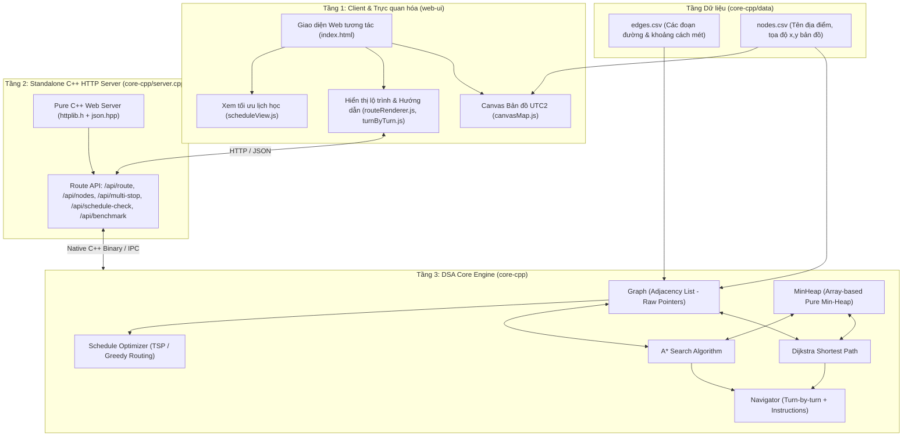

# KIẾN TRÚC HỆ THỐNG & QUY TẮC PHÁT TRIỂN
## BÀI TẬP LỚN: HỆ THỐNG DẪN ĐƯỜNG KHUÔN VIÊN UTC2
**Trường Đại học Giao thông Vận tải - Phân hiệu tại TP. Hồ Chí Minh (UTC2)**  
**Môn học:** Cấu trúc dữ liệu và Giải thuật (DSA)

---

## 1. TỔNG QUAN HỆ THỐNG

Dự án **"Hệ thống dẫn đường khuôn viên UTC2"** (UTC2 Campus Navigation System) là ứng dụng hỗ trợ sinh viên, giảng viên và khách tham quan tìm kiếm lộ trình di chuyển tối ưu nhất trong khuôn viên UTC2 (TP. Thủ Đức). Hệ thống kết hợp giữa tính toán giải thuật hiệu năng cao bằng C++ thuần và giao diện tương tác bản đồ trực quan.

### Các tính năng chính:
1. **Tìm đường ngắn nhất (Shortest Path Finding):** Ứng dụng giải thuật **Dijkstra** và **A\*** (A-Star với heuristic khoảng cách Euclidean).
2. **Quản lý danh sách địa điểm khuôn viên:** Các tòa nhà (A1-A4, C1-C4, E1-E2), Ký túc xá (KTX A, KTX B), Thư viện, Căn tin, Sân thể thao, Bãi đỗ xe, Cổng chính, Cổng phụ.
3. **Tối ưu hóa lịch học (Schedule Optimizer):** Gợi ý thứ tự di chuyển giữa các phòng học/giảng đường theo thời khóa biểu trong ngày, giảm thiểu tổng quãng đường đi bộ.
4. **Chỉ đường từng bước (Turn-by-turn Navigation):** Hướng dẫn trực quan từng đoạn đường rẽ trái/phải, khoảng cách và thời gian ước tính.

---

## 2. QUY TẮC CÔNG NGHỆ VÀ RÀNG BUỘC DSA (DSA RULES)

Dự án được xây dựng phục vụ môn Cấu trúc dữ liệu & Giải thuật, do đó phải tuân thủ nghiêm ngặt các quy tắc kỹ thuật sau:

### 2.1. Quy tắc cấu trúc dữ liệu thuần (Pure Data Structures)
* **Đồ thị (Graph):**
  * Lưu trữ dưới dạng **Danh sách kề (Adjacency List)**.
  * Cạnh kề biểu diễn bằng cấu trúc danh sách liên kết đơn với con trỏ thuần:
    ```cpp
    struct EdgeNode {
        std::string dest;    // Tên đỉnh đích
        double weight;       // Trọng số (khoảng cách thực tế tính bằng mét)
        EdgeNode* next;      // Con trỏ tới cạnh kề tiếp theo
    };
    ```
  * **Tuyệt đối không sử dụng `std::vector` hay `std::list` bên trong cấu trúc lưu trữ nội tại của đồ thị.**
  * Danh sách các đỉnh được quản lý bằng mảng động con trỏ thuần `VertexNode* vertices` với cơ chế cấp phát lại (resize doubling) thủ công khi vượt quá sức chứa.
* **Hàng đợi ưu tiên (Min-Heap):**
  * Tự cài đặt Min-Heap thuần trên mảng động (`HeapNode* heapArray`), **không sử dụng `std::priority_queue`**.
  * Lưu trữ cặp `(nodeName, distance)` phục vụ giải thuật Dijkstra và A\*.
  * Hỗ trợ đầy đủ các thao tác: `insert`, `extractMin`, `decreaseKey`, `siftUp`, `siftDown`.

### 2.2. Quy tắc quản lý bộ nhớ (Memory Management & Zero Leak)
* Mọi vùng nhớ cấp phát bằng toán tử `new` hoặc `new[]` phải có toán tử `delete` hoặc `delete[]` giải phóng tương ứng.
* Thực hiện đúng **Quy tắc ba (Rule of Three)** cho tất cả các lớp tự quản lý bộ nhớ (`Graph`, `MinHeap`):
  1. **Destructor:** Thu hồi triệt để toàn bộ danh sách liên kết và mảng động.
  2. **Copy Constructor:** Thực hiện Deep Copy để tránh lỗi dangling pointer.
  3. **Copy Assignment Operator (`operator=`):** Kiểm tra tự gán (`this == &other`), giải phóng tài nguyên cũ trước khi cấp phát tài nguyên mới.
* Tuyệt đối không để xảy ra rò rỉ bộ nhớ (Memory Leak) hoặc Double Free.

---

## 3. KIẾN TRÚC TỔNG THỂ HỆ THỐNG (SYSTEM ARCHITECTURE)

Hệ thống được thiết kế theo mô hình 3 tầng (3-tier architecture):



---

## 4. CHI TIẾT CÁC THÀNH PHẦN CORE C++

### 4.1. Cấu trúc Đồ thị (`Graph`)
- **File:** `core-cpp/include/Graph.h` & `core-cpp/src/Graph.cpp`
- **Mô hình:** Đồ thị vô hướng (Undirected Graph) có trọng số không âm (khoảng cách thực tế mét).
- **Cấu trúc dữ liệu:**
  ```
  VertexNode [0] (G)   (Cổng số 451)        -> [T, 28m] -> nullptr
  VertexNode [1] (T)   (Ngã ba sau Cổng 451)-> [J, 36m] -> [W1, 55m] -> [G, 28m] -> nullptr
  ...
  VertexNode [k] (A2)  (Nhà E1)             -> [Z4, 16m] -> [E7, 28m] -> [A1, 32m] -> [S2, 39m] -> nullptr
  ```
- **Các hàm quan trọng:**
  - `loadNodesFromCSV(const std::string& filePath)`: Nạp danh sách đỉnh, tên tiếng Việt và mô tả chi tiết từ `nodes.csv`.
  - `loadEdgesFromCSV(const std::string& filePath)`: Nạp các cung đường vô hướng từ `edges.csv`.
  - `loadFromCSV(const std::string& filePath)`: Tự động nạp cả `nodes.csv` và `edges.csv`.
  - `addVertex(name, displayName, description)`: Thêm một địa điểm vào danh sách đỉnh.
  - `addEdge(src, dest, weight)`: Thêm cạnh vô hướng (2 chiều) giữa `src` và `dest`.
  - `getNeighbors(name)`: Lấy con trỏ đầu danh sách kề của đỉnh.
  - `clear()`: Thu hồi toàn bộ bộ nhớ cấp phát động.

### 4.2. Cấu trúc Min-Heap (`MinHeap`)
- **File:** `core-cpp/include/MinHeap.h` & `core-cpp/src/MinHeap.cpp`
- **Mô hình:** Binary Min-Heap được biểu diễn dưới dạng mảng 1 chiều động (`HeapNode*`).
- **Phần tử:**
  ```cpp
  struct HeapNode {
      std::string name;    // Mã nút (ví dụ: "G", "C1", "E7")
      double distance;     // Khoảng cách ngắn nhất hiện tại (key ưu tiên)
  };
  ```
- **Quan hệ chỉ số (0-indexed):**
  - Cha của $i$: `parent = (i - 1) / 2`
  - Con trái của $i$: `left = 2 * i + 1`
  - Con phải của $i$: `right = 2 * i + 2`
- **Các thao tác chính:**
  - `insert(name, distance)`: Thêm phần tử mới và `siftUp` đưa về đúng vị trí ($O(\log N)$).
  - `extractMin()`: Lấy và xóa phần tử có `distance` nhỏ nhất tại gốc, đưa phần tử cuối lên và `siftDown` ($O(\log N)$).
  - `decreaseKey(name, newDistance)`: Cập nhật giảm khoảng cách của đỉnh và `siftUp` ($O(\log N)$ khi biết vị trí hoặc $O(N)$ tìm kiếm).
  - `isEmpty()`, `getSize()`, `peek()`.

---

## 5. ĐỊNH DẠNG DỮ LIỆU CHUẨN

### 5.1. File `core-cpp/data/edges.csv`
Biểu diễn các cung đường nối giữa các địa điểm trong khuôn viên UTC2:
```csv
source,target,weight
G,T,28
T,W1,55
T,J,36
J,V1,17
J,K,25
K,C1,25
...
```
- `source`: Mã nút bắt đầu.
- `target`: Mã nút kết thúc.
- `weight`: Chiều dài đoạn đường (đơn vị: mét, số thực `double`).

### 5.2. File `core-cpp/data/nodes.csv`
Biểu diễn thông tin danh sách địa điểm khuôn viên UTC2:
```csv
id,name,description
G,Cổng số 451,Điểm xuất phát chính (Đường Lê Văn Việt)
T,Ngã ba sau Cổng 451,Giao giữa Đại lộ Thành công và đường nhỏ dưới công viên
J,Ngã tư dưới CV Thành công,Giao lối lên V1 và sang cụm C
K,Nhà C2,Phòng học C2
C1,Nhà C1,Hội trường C1
...
```

---

## 6. HƯỚNG DẪN BIÊN DỊCH VÀ KIỂM THỬ

### 6.1. Biên dịch trực tiếp bằng `g++`:
```powershell
# Biên dịch test Graph và MinHeap
g++ -std=c++17 -Wall -Wextra -I core-cpp/include core-cpp/src/Graph.cpp core-cpp/src/MinHeap.cpp core-cpp/src/main.cpp -o core-cpp/campus_nav.exe
```

### 6.2. Chạy chương trình:
```powershell
./core-cpp/campus_nav.exe
```

